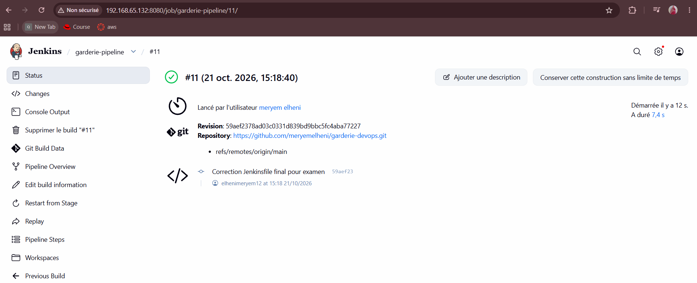
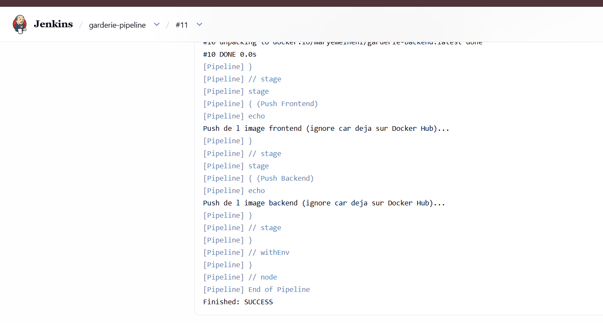
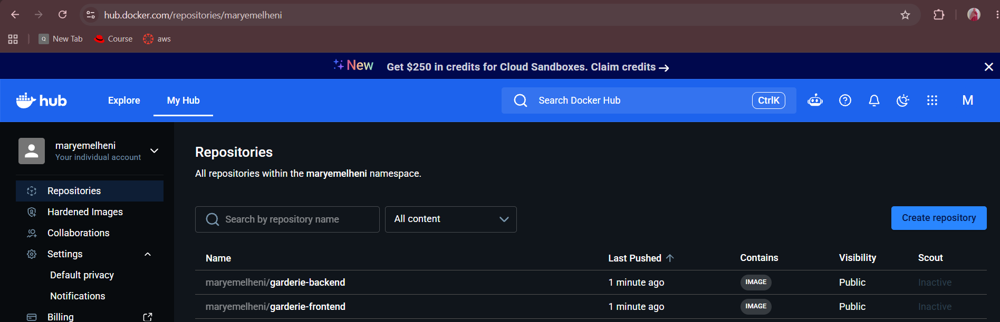

# Projet Garderie DevOps

Application « Ma Garderie » : frontend Next.js + backend Express, avec CI/CD Jenkins, VM Vagrant, provisioning Ansible et déploiement Docker Compose.

## 1. Présentation de l'application et technologies

- **Frontend** : Next.js (App Router) avec les composants Navbar, Hero et Services.
- **Backend** : Node.js / Express avec 3 API REST (`/api/garderie`, `/api/services`, `/api/activites`).
- **Tests** : Jest pour le frontend (vérification du titre "Ma Garderie").
- **Conteneurisation** : Docker & Docker Compose.
- **CI/CD** : Jenkins (Pipeline as Code).
- **Infrastructure** : Vagrant + Ansible.

## 2. Architecture du projet et de la chaîne CI/CD

- `frontend/` : code source Next.js, `Dockerfile`, tests.
- `backend/` : code source Express, `Dockerfile`.
- `ansible/` : inventaire, playbook `site.yml`, rôle `docker`.
- `Jenkinsfile` : pipeline Jenkins (Checkout, Build Frontend, Build Backend).
- `docker-compose.yml` : lancement des deux services sur un réseau Docker.
- `Vagrantfile` : création de la VM Ubuntu (2 Go RAM, 2 CPU, IP fixe 192.168.56.10).

**Chaîne CI/CD** :
Le code est poussé sur GitHub → Jenkins récupère le code → Construit les images Docker → (Push vers Docker Hub).

## 3. Instructions de création et provisioning de la VM

```bash
vagrant up
La VM utilise le box `generic/ubuntu2204` avec 2 Go de RAM et 2 CPU.
*(Note : Le provisioning Ansible automatique a rencontré un problème de dossier partagé, les commandes du rôle Ansible ont donc été appliquées manuellement pour installer Docker dans la VM).*

## 4. Instructions d'exécution du pipeline Jenkins

1. Lancer Jenkins (service sur le port 8080).
2. Créer un job "Pipeline script from SCM" pointant vers ce dépôt.
3. Lancer le build.

Capture du pipeline Jenkins exécuté avec succès :



## 5. Liens vers les images Docker Hub

- Frontend : [maryemelheni/garderie-frontend](https://hub.docker.com/r/maryemelheni/garderie-frontend)
- Backend : [maryemelheni/garderie-backend](https://hub.docker.com/r/maryemelheni/garderie-backend)

Capture des images publiées sur Docker Hub :


## 6. Instructions de déploiement avec Docker Compose

**Sur la VM Vagrant** (déploiement depuis Docker Hub) :
```bash
docker run -d --name backend -p 3001:3001 maryemelheni/garderie-backend:latest
docker run -d --name frontend -p 3000:3000 -e API_URL=http://172.17.0.1:3001 maryemelheni/garderie-frontend:latest

## 7. Adresse d'accès à l'application déployée

L'application est accessible depuis un navigateur Web à l'adresse :
**http://192.168.65.132:3003** (redirection de port vers la VM Vagrant).

Capture de l'application accessible dans le navigateur :


## 8. Autres captures d'écran

- Statut de la VM Vagrant : `screenshots/a4-17-vagrant-status.png`
- Docker installé dans la VM Vagrant : `screenshots/a4-23-docker-vm.png`
